  

  I work where <b>code</b> meets <b>design</b> - building web and app experiences that look good <i>and</i> work well. 
  Always learning, always shipping, always one <code>console.log</code> away from a breakthrough.

  
  

<code>git commit -m "fix: life (attempt #404)"</code>

